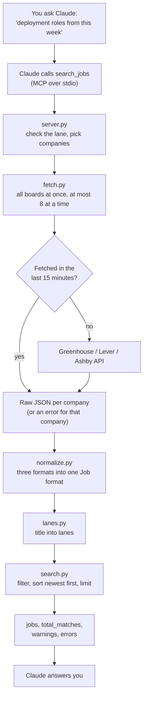

# job-board-mcp

An [MCP](https://modelcontextprotocol.io) server that lets Claude search open roles at companies I chose, using their **official, public job board APIs** (Greenhouse, Lever, and Ashby). It filters roles to my career lanes and reads full job descriptions, so I can ask Claude things like *"What deployment roles were posted this week?"* and get real, current answers.

I use it every day in my own job search.

## Why official APIs instead of scraping

Most job search tools scrape LinkedIn or Indeed, often through proxies to get around blocking. This project does the opposite:

- **Official APIs only.** Greenhouse, Lever, and Ashby publish unauthenticated job board endpoints that are meant to be read. No scraping, no proxies, no logins.
- **A short list of companies I chose,** not the whole internet. The APIs are per company, so this is also the only honest way to use them.
- **Light on requests.** Responses are cached for 15 minutes, at most 8 boards are fetched at once, and every request identifies the project with a `User-Agent` that links back here.
- **No credentials.** Nothing to sign up for and no API keys. Clone it and run it.

## Tools

| Tool | What it does |
|---|---|
| `list_companies()` | Lists the configured companies and the ATS each one uses |
| `search_jobs(lane?, keywords?, locations?, remote?, companies?, posted_within_days?, limit?)` | Searches every company's board at once and returns matching jobs in one format, newest first |
| `get_job(company, job_id)` | Returns one job's full description as plain text |

Every search result has the same fields, whatever ATS it came from: `company, title, location, remote, url, posted_at, ats, job_id, lanes`.

If one company's board fails (a wrong slug, a timeout), the search still returns everything else and lists the failure in `errors`. Individual postings with bad data are skipped and listed in `warnings`.

## Example prompts

- "Find deployment roles posted in the last 7 days."
- "Show me new grad roles at Decagon or Sierra."
- "Any remote PM roles in the last two weeks?"
- "Tell me more about the Cohere forward deployed engineer role. Does it fit someone fresh out of a CS degree?"
- "Which of my companies are hiring solutions engineers in New York?"

## Setup

**Requirements:** [uv](https://docs.astral.sh/uv/) and [Claude Code](https://docs.claude.com/en/docs/claude-code/overview). uv installs the right Python version (3.12+) for you.

```bash
git clone https://github.com/adeolaoj/job-board-mcp.git
cd job-board-mcp
uv sync
```

Register the server with Claude Code, using the absolute path to your clone:

```bash
# macOS / Linux
claude mcp add job-board -- uv --directory /path/to/job-board-mcp run job-board-mcp

# Windows (PowerShell)
claude mcp add job-board -- uv --directory "C:\path\to\job-board-mcp" run job-board-mcp
```

Add `--scope user` before `job-board` to make it available in every project. Check it with `claude mcp list`, or type `/mcp` inside Claude Code.

<details>
<summary>Using Claude Desktop instead</summary>

Add this to `claude_desktop_config.json` (on Windows: `%APPDATA%\Claude\claude_desktop_config.json`), then fully restart Claude Desktop:

```json
{
  "mcpServers": {
    "job-board": {
      "command": "uv",
      "args": ["--directory", "/path/to/job-board-mcp", "run", "job-board-mcp"]
    }
  }
}
```

If Claude Desktop can't find `uv`, use its full path (`which uv` or `where uv`).
</details>

To try the tools by hand, the MCP Inspector opens a browser UI:

```bash
uv run mcp dev src/job_board_mcp/server.py
```

## Configuration

**`config/companies.yaml`** lists the companies to search:

```yaml
- name: Addepar
  ats: greenhouse   # greenhouse | lever | ashby
  slug: addepar1
```

To find a slug, open one of the company's job postings and read the URL: `job-boards.greenhouse.io/{slug}`, `jobs.lever.co/{slug}`, or `jobs.ashbyhq.com/{slug}`. **Check it, don't guess**. A wrong slug shows up in `errors` on every search. The server refuses to start if the file is invalid (unknown ATS, missing field, duplicate name).

**`config/lanes.yaml`** defines career lanes as title keywords:

```yaml
lanes:
  deployment:
    - forward deployed
    - solutions engineer
  pm:
    - product manager
  new_grad:
    - new grad
    - early career
exclude:
  - senior
  - staff
```

Titles and keywords are split into words, ignoring case and punctuation, and a keyword matches when its words appear next to each other in the title. So `forward deployed` matches "Forward-Deployed Engineer", `grad` does **not** match "Upgrade", and `sr.` matches "Sr. Account Executive". A job matching any `exclude` keyword gets no lane.

## How it works



| Module | Job |
|---|---|
| `server.py` | MCP tools and the server lifespan (loads config, opens one shared HTTP client) |
| `fetch.py` | URLs for each ATS, async fetching, status checks, failure isolation |
| `cache.py` | A small hand-written cache whose entries expire after 15 minutes |
| `normalize.py` | Converts each ATS's response into the shared `Job` format, and builds descriptions |
| `lanes.py` | Matches titles to lanes |
| `search.py` | Filters, sorts, and formats results. Pure logic, no network |
| `text.py` | Turns description HTML into readable text, keeping bullet lists |
| `config.py` | Loads and validates `companies.yaml` |

## Design decisions

Every decision was made against real API responses, not documentation alone, and several came from the data disagreeing with what I expected. [`docs/decisions.md`](docs/decisions.md) has the full record; some highlights:

- **The three APIs disagree on almost everything.** IDs are integers in Greenhouse and UUID strings elsewhere. Dates are ISO strings with offsets, ISO strings in UTC, or milliseconds since 1970. Greenhouse's descriptions are HTML escaped *twice*, Lever's plain-text description leaves out responsibilities and qualifications, and Ashby has no public endpoint for a single job.
- **The docs and the data disagreed too.** Lever documents `on-site`, but the data says `onsite`, so the normalizer accepts both.
- **Lane matching went through three versions.** Substring matching put "grad" in "Upgrade" and "intern" in "International". Regex word boundaries couldn't match "Sr." The final version splits titles into words, and the test suite keeps the real titles that broke the first two.
- **Bad data fails small.** A malformed posting is skipped with a warning, a failing company goes in `errors`, and the rest of the search still comes back.
- **The cache stores raw JSON, not results,** so one cache serves every ATS, and failed requests are never cached.

## Testing

```bash
uv run pytest
```

The tests never touch the network:

- **Fixtures are real API responses,** trimmed to a few postings chosen to include edge cases (same title for separate jobs, null remote fields, multi-city postings, double-escaped HTML) and otherwise unedited.
- **HTTP is faked with `httpx.MockTransport`,** so tests can return a plain-text 404, a timeout, or invalid JSON.
- **Time is injected.** The cache takes a clock and search takes `now`, so expiry and "posted within 7 days" tests don't depend on the real date.

## Limitations

- **Lanes match titles only.** A good role with an unusual title can be missed, and a keyword can't tell "Research Staff" (a job family) from "Staff Engineer" (a level).
- **Remote status is often unknown.** Greenhouse has no remote field, so it's only known when the location says "Remote".
- **Only Greenhouse, Lever, and Ashby.** Companies on other systems (Workday, or a Notion page) can't be added.
- **Local only.** The server runs on your machine over stdio. Hosting it for claude.ai would need an HTTP transport and authentication.

## Roadmap

- `add_company(careers_url)`: Claude finds a company, and the server checks its slug with one real request before saving it.
- `new_since_last_check()`: only jobs that weren't there on the last run.

## License

[MIT](LICENSE)
